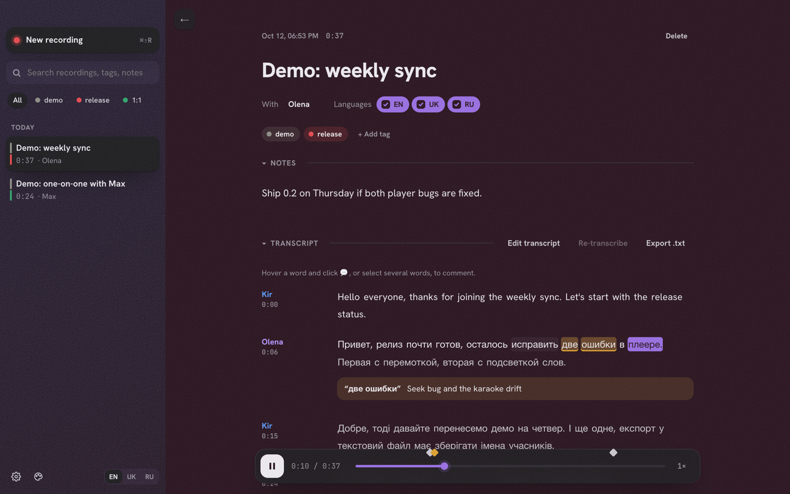
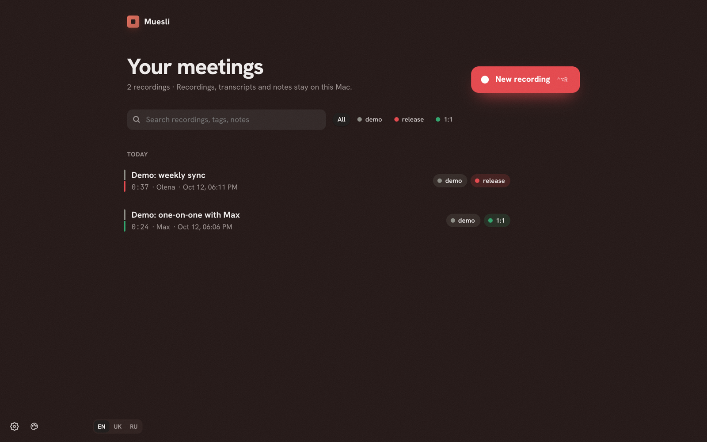
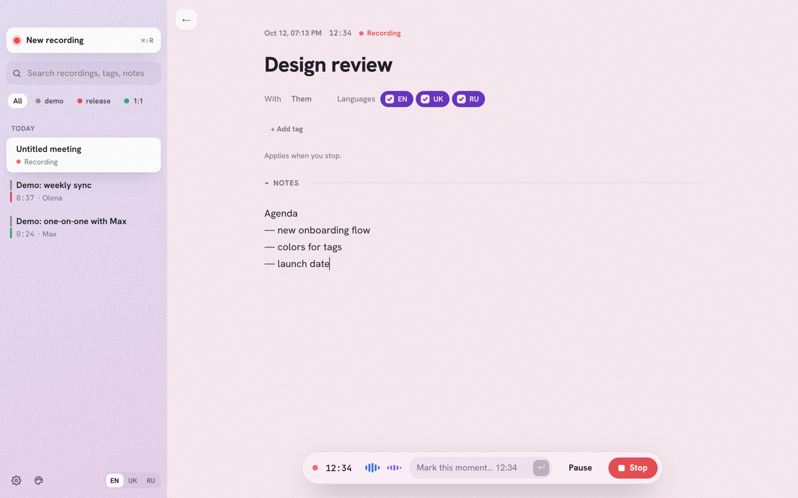
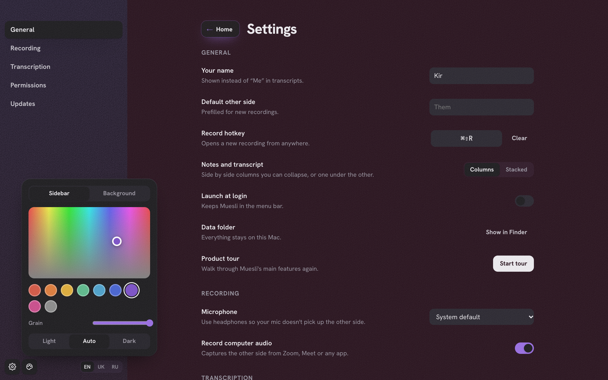

<div align="center">


# Muesli

**A private meeting recorder for macOS. Records you and the other side on separate channels, transcribes on your Mac, and keeps everything local.**

[](https://github.com/Bazeltsev-k/Muesli/actions/workflows/ci.yml)
[](https://github.com/Bazeltsev-k/Muesli/actions/workflows/release.yml)
[](https://github.com/Bazeltsev-k/Muesli/releases/latest)

[](LICENSE)

[**Download the latest release**](https://github.com/Bazeltsev-k/Muesli/releases/latest) · [Features](#features) · [Install](#install) · [Develop](#develop)



</div>

## Why Muesli

Meeting notes apps usually send your audio to someone else's servers. Muesli doesn't. It captures your microphone and your computer's audio as two separate channels, so every line of the transcript knows who said it, and it runs Whisper on your Mac's GPU. No accounts, no cloud, no subscription.

It was built for people who switch between English, Ukrainian and Russian in the same call.

## Features

**Recording**
- Your voice and the other side (Zoom, Meet, Teams, anything) recorded on separate channels
- Start from the app, the menu bar or a global hotkey (default `⌘⇧R`)
- Name the recording, set who you're talking with and which languages to expect before pressing Start
- Write notes while you record and mark moments with a timestamp
- Keep browsing while recording; a floating panel keeps the timer, levels, marks and Stop at hand

**Transcription**
- Whisper large-v3-turbo running locally with Metal acceleration, about 4–5 minutes per hour of audio on an M4
- English, Ukrainian and Russian; each utterance is matched to the languages you checked for that recording
- Proper sentences and punctuation, paragraphs split on pauses
- Re-transcribe any time with different languages

**Reviewing**
- Karaoke playback: the current word is highlighted and clicking any word jumps there
- Comment on a word or a selection; comments and notes show as markers on the timeline
- Edit the transcript in place
- Playback continues in a mini player while you look at other recordings
- Export to `.txt` with speaker names and timestamps

**Organizing**
- Colored tags with rename, recolor and delete, shown as a notch on each recording
- Search across titles, people, notes, tags and transcripts
- Rename, tag and delete straight from the home page

**Making it yours**
- Pick sidebar and background colors, grain and how floating panels stand out, with live previews
- Light, dark or follow the system
- Interface in English, Ukrainian and Russian
- A short walkthrough on first launch, using two demo recordings you can delete

## Screenshots

<table>
  <tr>
    <td></td>
    <td></td>
  </tr>
  <tr>
    <td align="center">Home</td>
    <td align="center">Recording, light theme</td>
  </tr>
  <tr>
    <td></td>
    <td></td>
  </tr>
  <tr>
    <td align="center">Transcript, comments and player</td>
    <td align="center">Settings and appearance</td>
  </tr>
</table>

## Install

1. Download `Muesli_*_aarch64.dmg` from the [latest release](https://github.com/Bazeltsev-k/Muesli/releases/latest) and drag Muesli to Applications.
2. Muesli isn't notarized by Apple yet, so clear the quarantine flag once:
   ```sh
   xattr -cr /Applications/Muesli.app
   ```
3. Open Muesli. The walkthrough ends by downloading the transcription model (574 MB) and allowing microphone and system audio access.

Updates install themselves from inside the app.

Use headphones during calls so your microphone doesn't pick up the other side.

## Privacy

Recordings, transcripts, notes and settings live in `~/Library/Application Support/com.bazeltsev.muesli` and never leave your Mac. The only network requests are the one-time model download from Hugging Face and the update check against GitHub Releases, which you can turn off.

## How it works

```
┌──────────── React UI (Tauri webview) ─────────────┐
│ home · recording · settings · walkthrough          │
└──────────────── commands / events ─────────────────┘
┌──────────────────── Rust core ─────────────────────┐
│ SQLite library · transcription queue · model download │
│ whisper.cpp (Metal) with per-utterance language     │
│ detection and word timestamps                       │
└───────────────────── sidecar ──────────────────────┘
┌──────────────── Swift audio helper ────────────────┐
│ Core Audio process tap + microphone → stereo AAC    │
│ permissions · decoding for transcription            │
└─────────────────────────────────────────────────────┘
```

- `src/`: React interface
- `src-tauri/src/`: Rust core (database, transcription, commands)
- `src-tauri/recorder/main.swift`: audio helper, built by `build.rs` and bundled as a sidecar
- `src-tauri/demo/`: demo recordings loaded on first launch

## Develop

Requirements: macOS 14.4+ on Apple Silicon, Xcode Command Line Tools, Rust, [Bun](https://bun.sh) and CMake (`brew install cmake`).

```sh
bun install
bun tauri dev
```

Tests:

```sh
bun run test
cd src-tauri && cargo test
```

The end-to-end transcription test runs when the model is present in `~/Library/Application Support/com.bazeltsev.muesli/models`.

## Releasing

1. Bump `version` in `src-tauri/tauri.conf.json`, `src-tauri/Cargo.toml` and `package.json`.
2. Tag and push: `git tag v0.2.0 && git push --tags`.

The Release workflow builds the app, signs the update and publishes a GitHub release with `latest.json` for the in-app updater. Running the workflow by hand creates a draft instead.

## License

[MIT](LICENSE) © Kirill Bazeltsev
